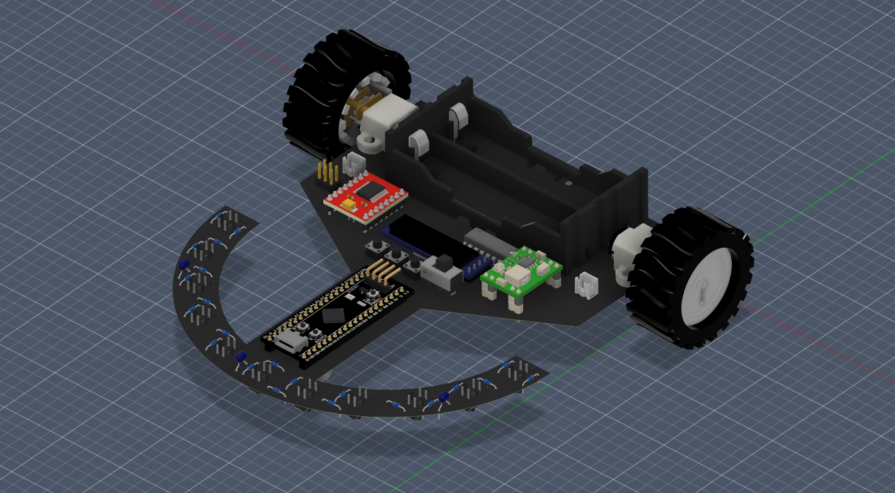
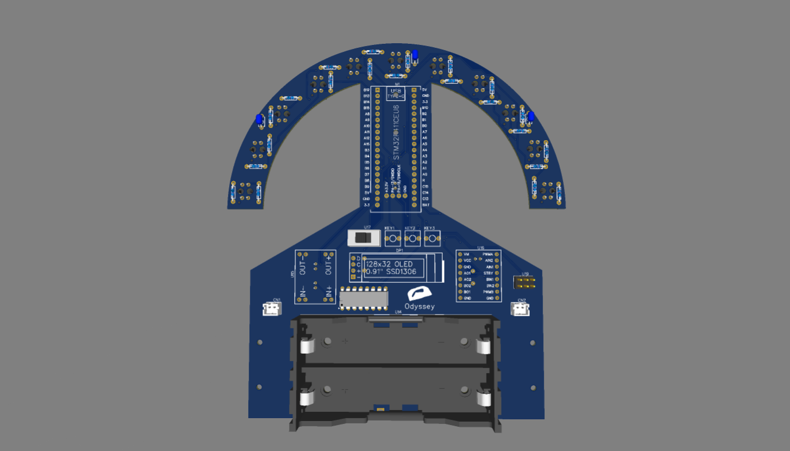
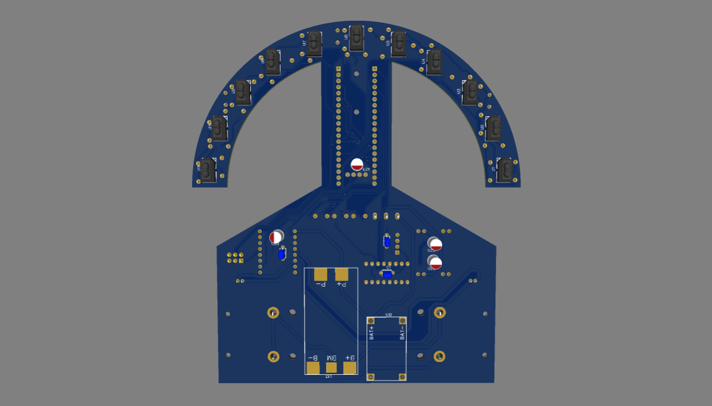
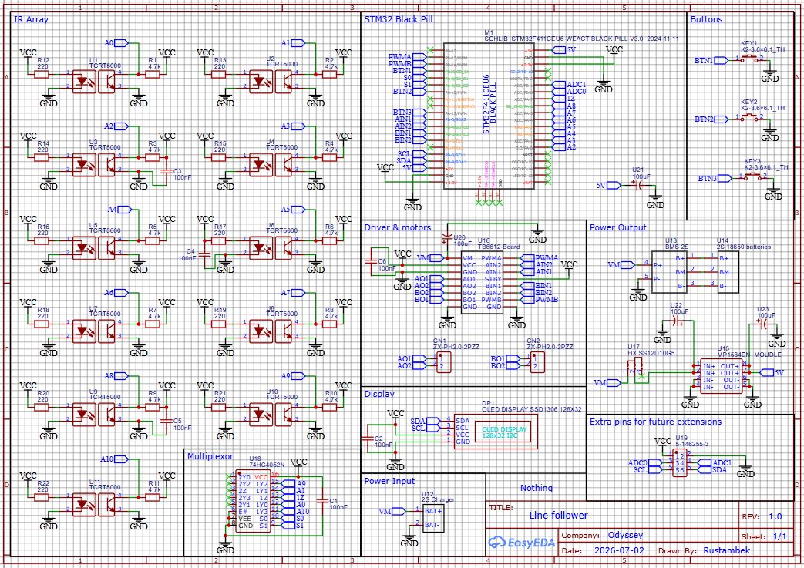

# Line follower v3

## About

Its the 3rd version of this project because I needed to reduce the costs of assembling

I see many competition robots use curved IR array, and this design is more effective than flat array. Therefore, I made my design curved by half arc. Also, I used STM32 black pill, because it has more analog pins, but still used multiplexor to read remaining sensors

## Features
- PID control with 11 sensors
- OLED Display for debugging
- Buttons for controls
- Battery protection + BMS
- USB-C Charging
- Additional pins for future extensions

## PCB & CAD
This project was made in EasyEDA Standard, therefore there may be some DRC errors in converted EasyEDA Pro file

- Project files are in the `PCB` folder
- Production files are in the `Fabrication` folder
- CAD Assembly is provided in `assembly.step` file
- Project is also available in [OSHWLab](https://oshwlab.com/begmetovrustambek/project_kacasgaj)

## Images

### Top view

### Bottom view

### Schematic

## BOM

`.csv` version in `bomlist.csv`

Total BOM Cost: `45.63 USD`

PCB Cost: `15.55 USD`

Total delivery cost: ~`35 USD`

**Total requested amount:** `95 USD`

|Name|Quantity                                             |Total Cost (USD)                           |Link                              |
|---|-----------------------------------------------------|-------------------------------------------|----------------------------------|
|WeAct STM32F411CEU6  board|1                                                    |3.34                                       |https://ali.click/al9kh1r         |
|ST-Link V2|1                                                    |1.51                                       |https://ali.click/cs6jh16         |
|SN74HC4052N DIP-16|1                                                    |2.25                                       |https://ali.click/yx4jh1f         |
|DIP IC sockets 16 pin|1                                                    |0.99                                       |https://ali.click/ek5jh1s         |
|18650 batteries|2                                                    |13.01                                      |https://ali.click/bf5jh18         |
|18650 battery case|1                                                    |0.35                                       |https://ali.click/neqfh1u         |
|HX-2S-JH20|1                                                    |0.75                                       |https://ali.click/h8rfh14         |
|Charging module|1                                                    |0.79                                       |https://ali.click/khrfh1q         |
|MP1584|1                                                    |0.56                                       |https://ali.click/1xrfh1j         |
|2S battery indicator|1                                                    |0.61                                       |https://ali.click/8odkh1w         |
|Switch|1                                                    |0.95                                       |https://ali.click/oqqfh1v         |
|TB6612FNG motor driver|1                                                    |1.13                                       |https://ali.click/yopfh18         |
|N20 motor 6V500RPM|2                                                    |2.92                                       |https://ali.click/pgakh13         |
|N20 motor mounts|1                                                    |0.96                                       |https://ali.click/qxbkh1a         |
|N20 motor wheel|2                                                    |2.14                                       |https://ali.click/5xqfh1v         |
|JST  PH2.0mm 2P pack|1                                                    |0.53                                       |https://ali.click/zcsfh1b         |
|Robot ball caster|1                                                    |0.33                                       |https://ali.click/5nakh1w         |
|0.91 OLED display|1                                                    |1.49                                       |https://ali.click/0v9kh1e         |
|2 pin tactile switches pack|1                                                    |1                                          |https://ali.click/njqfh1d         |
|TCRT5000 pack|2                                                    |1.78                                       |https://ali.click/v7qfh14         |
|Resistor pack 4.7K|1                                                    |0.75                                       |https://ali.click/otpfh1j         |
|Resistor pack 220|1                                                    |0.75                                       |https://ali.click/0ypfh1k         |
|Ceramic capacitor pack 0.1uF|1                                                    |0.95                                       |https://ali.click/mn5jh1r         |
|Electrolytic capacitor pack 16V100uF|1                                                    |1.11                                       |https://ali.click/o76jh1g         |
|Male pin headers|1                                                    |1.52                                       |https://ali.click/hp7jh1o         |
|Female pin headers|2                                                    |3.16                                       |https://ali.click/6v7jh1h         |
|Total cost|1                                                    |45.63                                       |N/A        |
